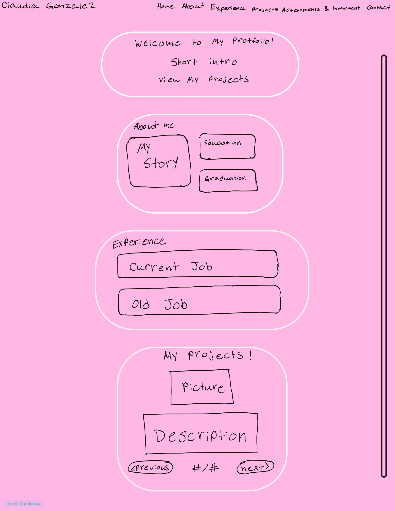
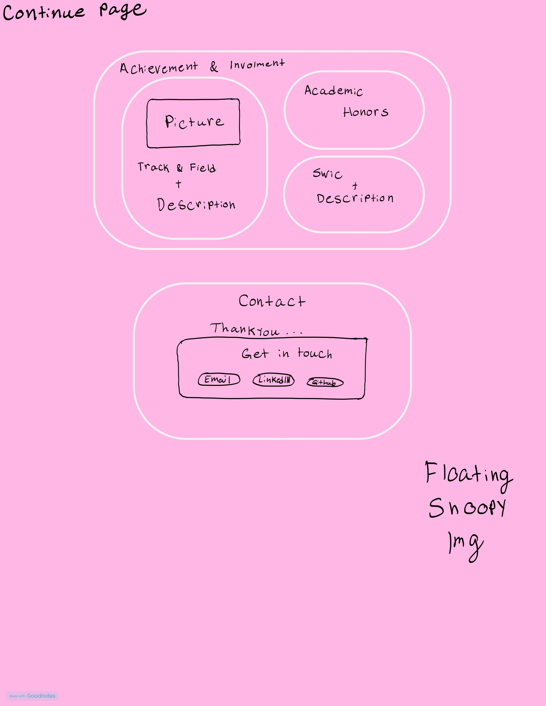

# Claudia's Project-1-WEB-DEVELOPMENT 

## Overview
This is my personal portfolio that showcases my background, college projects, achievements, and experiences as a Computer Programming and Information System student.

## Timeline / Project Milestones
1. Planning- I will answer all 30 questions to figure out what I want to do. As well as include the information i have to add.
2. Design - I will Choose colors, fonts, and layout.
3. HTML - Created the sections of my website.
4. CSS - Added styling snd made my website resposive.
5. JavaScript - Created the Projevt carousel.
6. Testing - Tested my website using Github Pages.
7. Deployment - Published my website using Github Pages.
8. Documentation - Completed my README and wireframe.

## Part 1: Content

### 1. What is your full name as you want it displayed professionally?
Claudia Gonzalez

### 2. What is the purpose of your portfolio website?
The purpose is to show whoever sees my portfolio who i am and what I have done in my college career.

### 3. Who is the target audience (employers, clients, peers, etc.)?
My target audience are my peers, as well as anyone who sees my profile.

### 4. What skills do you want to highlight?
I want to highlight my SQL and database skills, as well as my creative side.

### 5. What projects or work will you showcase?
I will showcase my BSC350 final assignment which is a student portal, my Ai-Academic Planning project, and Smart park which I did through my years in college.

### 6. How will you describe yourself in a short professional bio?
I will describe myself by describing what I like doing most so far which is dealing with Data.

### 7. What pages will your site include (Home, About, Projects, Contact, etc.)?
I will Include Home, about, Projects, Achievements and Involvement, and Contact which will include Email, LinkedIn, and GitHub.

### 8. What is your career goal or desired role?
I would love to be a Data Analyst.

### 9. What technologies or tools do you have experience with?
I have experience with Java, MySQL/SQL, Excel, and Microsoft Access, GitHub, Figma, Visual Studios Code, HTML.

### 10. What achievements or experiences are worth highlighting?
My skyline achievement is important to me. Making the Dean's and Presidents list and just being involved in Swic here at Farmingdale would be good to add in this portfolio.

### 11. What call-to-action should visitors take (contact you, view projects, download resume)?
They should contact me when visiting my profile as well as the user viewing my projects.

### 12. Will you include a resume? In what format?
No, in this portfolio I will not add my resume.

### 13. What social or professional links will you include (GitHub, LinkedIn, etc.)?
It will include my Email, LinkedIn, and GitHub.

--------------------------------------------------
## PART 2: DESIGN

### 1. What overall style will best represent you (minimalist, creative, professional, etc.)?
I want my website to show my creative side while still looking professional. My goal is to bring my vision to life by creating something that looks pretty, organized, and easy for visitors to use.  

### 2. What color scheme will you use and why?
I decided to use Pink and add snoopy in the website since he is one of my favorite characters of all time. I used pink since pink and snoopy are complementary to one another.

### 3. What fonts will you use for headings and body text?
I will use Georgia for my headings because it gives them a more elegant appearance. For the body text, I will use Arial because it is simple and easy to read. I will also use different font sizes and bold text to highlight important information.

### 4. How will your design reflect your personality or field?
My website will reflect my personality by combining creativity with organization. Since I am studying Computer Programming and Information Systems, I want to show that I can create a functional website while also paying attention to its appearance.

### 5. What layout will your homepage follow?
My homepage will have a navigation bar at the top and a large welcome card in the center. The card will introduce me and provide a button that takes visitors to my projects. I will also include a floating Snoopy decoration in the bottom-right corner.

### 6. How will you organize project sections visually?
I will organize my projects using a carousel that displays one project at a time. Each project will include a title, an image, a description, and the technology I used, or my role. Visitors will be able to use the Previous and Next buttons to look through my projects.

### 7. Will the site be mobile-friendly? How will you ensure responsiveness?
Yes, I want my website to work on both computers and mobile devices. I will use CSS media queries to adjust the sizes of my cards, images, navigation menu, and text depending on the screen size.

### 8. What visual hierarchy will guide visitors?
I will use large headings, different font sizes, and separate cards to help visitors understand which information is most important. The navigation bar will help visitors find specific sections, and the project images will help draw attention to my work.

### 9. How will consistency be maintained across pages?
I will use the same pink color scheme, fonts, buttons, and rounded cards in my website.

### 10. How will accessibility be considered (contrast, font size, readability)?
I will use dark-colored lettering on light pink backgrounds to make the information easier to read. I will also make sure the font sizes are readable, the labels are clear and the images match up with the paragraph.

### 11. Will you use icons, images, or illustrations? Why?
I will be included my images of my projects, a track and field photo of myself, and a snoopy transparent picture to appear on the website.

### 12. What portfolio websites inspired your design?
I looked at creative portfolio designs that uses rounded cards and simple navigation. I liked how these designs could look personal while still being organized and professional. I used those ideas to create my own pink-themed portfolio.
--------------------------------------------------
## PART 3: INTERACTIVITY 

### 1. What interactive elements will your site include (navigation menus, buttons, forms)?
My website will include a navigation menu, buttons, and a project carousel. The navigation menu will allow visitors to move between the different sections, while the carousel buttons will let them view my projects.

### 2. Will your site include a contact form? How will it work?
No I will add buttons with all my contact information that display my email, GitHub, and LinkedIn. When people press these buttons they will be taken to the email LinkedIn or my GitHub.

### 3. What JavaScript features will you implement?
I will use JavaScript to create a project carousel. Visitors will be able to click the Previous and Next buttons to switch between projects. The carousel will also display a counter showing which project they are viewing and how many projects there are.

### 4. How will users receive feedback from interactions?
The Users will receive feedback based on the button they pressed. For example when they click next in the carousel it will display a different project.

### 5. How does interactivity improve the user experience?
Interactivity will make the webpage easier to navigate. The navigation element will allow visitors to quickly find the information they are interested in reading as well.

## WireFrame
I drew out a sketch in Good Notes to show how I wanted my design and layout to be.

### Page 1

### Page 2

## Technical Overview
I used HTML to create the structure of my porfolio website. Then i added CSS to design the colors, font, cards, layouts, and pictures. JavaScript was used to make the carousel work by having it switch slides at a click. This website was devoloped using Visual Studio Code which I had to push into Github with commits and later on publish my portfolio using GitHub Pages.

## External Resources
The following Resources helped me created my porfolio website.
- Visual Studio Code: https://code.visualstudio.com/
- GitHub: https://github.com/
- Github Pages: https://pages.github.com/
- Goodnotes: https://www.goodnotes.com/
- Snoopy Images: https://dk.pinterest.com/pin/4222193395778561/ 
- Tranparency edited used ChatGpt
- Bootstrap Carousel: https://getbootstrap.com/docs/5.3/components/carousel/
-  CSS Colors: https://www.w3schools.com/css/css_colors.asp
- CSS Pink Color Palette: https://htmlcolorcodes.com/colors/shades-of-pink/
- CSS Flexbox Tutorial (Kevin Powell): https://www.youtube.com/watch?v=u044iM9xsWU 